# FLAMO CRM — Arquitectura de la base de datos (esquema v6)

> Estado: **Fases 1 a 4 implementadas, probadas y verificadas** (migraciones 001–006; 41 tablas; 282 pruebas automatizadas). Ver §9 para lo que sigue pendiente.
> Documentos relacionados: `DATABASE_AUDIT.md` (hallazgos y evidencia previa), `DATABASE_REFACTOR_PLAN.md` (plan por fases),
> `DATA_DICTIONARY.md` (tablas y columnas), `schema.sql` (DDL), `CHANGELOG_DB.md` (registro de cambios).

## 1. Stack
MySQL/MariaDB (InnoDB, utf8mb4) vía PDO desde PHP 8 (`public/api`). Sin ORM. React como cliente.
Migraciones: `public/api/migrations/NNN_*.php` (cada una con `up()` y `down()`), ejecutor en `public/api/schema.php`,
CLI en `scripts/db/migrate.php`, endpoint de administración `api/migrate.php` (solo Super Admin).
**Probado únicamente en MariaDB 10.11.** La versión del MySQL de tu hosting no está verificada (ver §8).

## 2. Diagrama entidad-relación (Mermaid)

```mermaid
erDiagram
    cat_etapas_desarrollo ||--o{ artistas : "etapa_id (RESTRICT)"
    cat_roles_contacto ||--o{ artista_contactos : "rol_id (RESTRICT)"
    artistas ||--o{ artista_contactos : "artista_id (CASCADE)"
    contactos ||--o{ artista_contactos : "contacto_id (CASCADE)"
    artistas ||--o{ artista_generos : "artista_id (CASCADE)"
    cat_generos ||--o{ artista_generos : "genero_id (RESTRICT)"
    artistas ||--o{ artista_hitos : "artista_id (CASCADE)"
    artistas ||--o{ artista_idiomas : "artista_id (CASCADE)"
    artistas ||--o{ artista_integrantes : "artista_id (CASCADE)"
    artistas ||--o{ artista_pipeline : "artista_id (CASCADE)"
    artistas ||--o{ artista_redes : "artista_id (CASCADE)"
    contactos ||--o{ contacto_correos : "contacto_id (CASCADE)"
    contactos ||--o{ contacto_telefonos : "contacto_id (CASCADE)"
    contratos ||--o{ contrato_artistas : "contrato_id (CASCADE)"
    artistas ||--o{ contrato_artistas : "artista_id (RESTRICT)"
    eventos ||--o{ contrato_eventos : "evento_id (RESTRICT)"
    contratos ||--o{ contrato_eventos : "contrato_id (CASCADE)"
    contratos ||--o{ contrato_proveedores : "contrato_id (CASCADE)"
    proveedores ||--o{ contrato_proveedores : "proveedor_id (RESTRICT)"
    contratos ||--o{ contrato_tours : "contrato_id (CASCADE)"
    tours ||--o{ contrato_tours : "tour_id (RESTRICT)"
    contratos ||--o{ contrato_venues : "contrato_id (CASCADE)"
    venues ||--o{ contrato_venues : "venue_id (RESTRICT)"
    tours |o--o{ eventos : "tour_id (SET NULL)"
    venues ||--o{ eventos : "venue_id (RESTRICT)"
    artistas ||--o{ evento_artistas : "artista_id (RESTRICT)"
    cat_monedas ||--o{ evento_artistas : "moneda (RESTRICT)"
    eventos ||--o{ evento_artistas : "evento_id (CASCADE)"
    eventos ||--o{ evento_bandas_invitadas : "evento_id (CASCADE)"
    eventos ||--o{ evento_setlist : "evento_id (CASCADE)"
    proveedores ||--o{ proveedor_contactos : "proveedor_id (CASCADE)"
    contactos ||--o{ proveedor_contactos : "contacto_id (CASCADE)"
    cat_roles_contacto ||--o{ proveedor_contactos : "rol_id (RESTRICT)"
    artistas |o--o{ proyectos_grabacion : "artista_id (RESTRICT)"
    proyectos_grabacion ||--o{ proyecto_canciones : "proyecto_id (CASCADE)"
    proyectos_grabacion ||--o{ proyecto_costos : "proyecto_id (CASCADE)"
    proyectos_grabacion ||--o{ proyecto_etapas : "proyecto_id (CASCADE)"
    proyecto_etapas ||--o{ proyecto_instrumentos : "proyecto_id (CASCADE)"
    proyecto_etapas ||--o{ proyecto_instrumentos : "etapa_id (CASCADE)"
    proyectos_grabacion ||--o{ proyecto_pagos : "proyecto_id (CASCADE)"
    tours ||--o{ tour_artistas : "tour_id (CASCADE)"
    artistas ||--o{ tour_artistas : "artista_id (RESTRICT)"
    venues ||--o{ venue_bandas_locales : "venue_id (CASCADE)"
    cat_roles_contacto ||--o{ venue_contactos : "rol_id (RESTRICT)"
    venues ||--o{ venue_contactos : "venue_id (CASCADE)"
    contactos ||--o{ venue_contactos : "contacto_id (CASCADE)"
    venues ||--o{ venue_horarios : "venue_id (CASCADE)"
    venues ||--o{ venue_notas : "venue_id (CASCADE)"
    eventos |o--o{ venue_notas : "evento_id (SET NULL)"
    proveedores ||--o{ venue_proveedores : "proveedor_id (CASCADE)"
    venues ||--o{ venue_proveedores : "venue_id (CASCADE)"
    artistas {
        varchar id PK
        varchar nombre_artistico
        varchar nombre_legal
        tinyint etapa_id FK
        varchar isrc_default
        varchar iswc_default
        varchar sociedad_gestion
        varchar rfc
        varchar ciudad
        varchar estado
        varchar pais
        text foto
        text bio
        date fecha_inicio
        varchar sello
        varchar editorial
        varchar distribuidora
        decimal foto_zoom
        decimal foto_rotacion
        decimal foto_contraste
        decimal foto_brillo
        decimal foto_grises
        decimal foto_sepia
        decimal foto_desenfoque
    }
    artista_contactos {
        varchar artista_id PK,FK
        varchar contacto_id PK,FK
        smallint_unsigned rol_id PK,FK
        tinyint es_principal
    }
    artista_generos {
        varchar artista_id PK,FK
        smallint_unsigned genero_id PK,FK
        tinyint es_principal
        tinyint_unsigned orden
    }
    artista_hitos {
        varchar artista_id PK,FK
        varchar hito_id PK
        smallint_unsigned orden
        date fecha
        varchar titulo
        text descripcion
        varchar tipo
    }
    artista_idiomas {
        varchar artista_id PK,FK
        varchar idioma PK
        tinyint_unsigned orden
    }
    artista_integrantes {
        varchar artista_id PK,FK
        varchar integrante_id PK
        smallint_unsigned orden
        varchar nombre
        varchar rol
        date fecha_inicio
        date fecha_fin
        varchar lugar_inicio
        tinyint activo
    }
    artista_pipeline {
        varchar artista_id PK,FK
        varchar item_id PK
        smallint_unsigned orden
        varchar nombre
        varchar categoria
        tinyint completado
    }
    artista_redes {
        varchar artista_id PK,FK
        varchar plataforma PK
        varchar enlace
        tinyint conectado
        varchar usuario_conectado
    }
    cat_etapas_desarrollo {
        tinyint id PK
        varchar nombre
    }
    cat_generos {
        smallint_unsigned id PK
        varchar nombre
        varchar descripcion
    }
    cat_monedas {
        char codigo PK
        varchar nombre
    }
    cat_roles_contacto {
        smallint_unsigned id PK
        varchar nombre
    }
    contactos {
        varchar id PK
        varchar nombre
        varchar apellidos
    }
    contacto_correos {
        bigint_unsigned id PK
        varchar contacto_id FK
        varchar correo
        varchar etiqueta
        tinyint es_principal
    }
    contacto_telefonos {
        bigint_unsigned id PK
        varchar contacto_id FK
        varchar telefono
        varchar etiqueta
        tinyint es_principal
    }
    contratos {
        varchar id PK
        varchar titulo
        varchar tipo
        varchar estado
        varchar nombre_archivo
        text notas
        datetime fecha_subida
        bigint tamano_bytes
    }
    contrato_artistas {
        varchar contrato_id PK,FK
        varchar artista_id PK,FK
    }
    contrato_eventos {
        varchar contrato_id PK,FK
        varchar evento_id PK,FK
    }
    contrato_proveedores {
        varchar contrato_id PK,FK
        varchar proveedor_id PK,FK
    }
    contrato_tours {
        varchar contrato_id PK,FK
        varchar tour_id PK,FK
    }
    contrato_venues {
        varchar contrato_id PK,FK
        varchar venue_id PK,FK
    }
    eventos {
        varchar id PK
        varchar nombre
        varchar venue_id FK
        varchar tour_id FK
        date fecha
        varchar estado
        int capacidad
        int asistencia
        decimal precio_boleto
        decimal ingreso_total
        decimal gastos_totales
        decimal utilidad
        text feedback_artista
        text reaccion_publico
        tinyint valoracion_ritmo
        text notas_optimizacion
    }
    evento_artistas {
        bigint_unsigned id PK
        varchar evento_id FK
        varchar artista_id FK
        varchar rol
        tinyint es_principal
        smallint_unsigned orden_presentacion
        time hora_inicio
        time hora_fin
        decimal honorarios
        char moneda FK
        varchar estado_confirmacion
    }
    evento_bandas_invitadas {
        varchar evento_id PK,FK
        smallint_unsigned orden PK
        varchar nombre
    }
    evento_setlist {
        varchar evento_id PK,FK
        varchar item_id PK
        smallint_unsigned orden
        varchar titulo
        int_unsigned duracion_seg
        varchar tempo
        text notas_transicion
    }
    proveedores {
        varchar id PK
        varchar nombre
        varchar categoria
        decimal rating
        decimal costo_por_show
        text notas
    }
    proveedor_contactos {
        varchar proveedor_id PK,FK
        varchar contacto_id PK,FK
        smallint_unsigned rol_id PK,FK
        tinyint es_principal
    }
    proyectos_grabacion {
        varchar id PK
        varchar titulo
        varchar artista_id FK
        varchar estado
        date fecha_lanzamiento
        varchar estudio
        varchar productor
    }
    proyecto_canciones {
        varchar proyecto_id PK,FK
        varchar cancion_id PK
        smallint_unsigned orden
        varchar titulo
        int_unsigned duracion_seg
        varchar compositor
        varchar estado
        tinyint_unsigned progreso
        text notas
    }
    proyecto_costos {
        varchar proyecto_id PK,FK
        varchar costo_id PK
        smallint_unsigned orden
        varchar concepto
        varchar categoria
        decimal monto
        text notas
    }
    proyecto_etapas {
        varchar proyecto_id PK,FK
        varchar etapa_id PK
        smallint_unsigned orden
        varchar nombre
        varchar estado
        date fecha_inicio
        date fecha_fin
        text notas
    }
    proyecto_instrumentos {
        varchar proyecto_id PK,FK
        varchar etapa_id PK,FK
        varchar instrumento_id PK
        smallint_unsigned orden
        varchar nombre
        varchar estado
        varchar musico
    }
    proyecto_pagos {
        varchar proyecto_id PK,FK
        varchar pago_id PK
        smallint_unsigned orden
        varchar concepto
        decimal monto
        date fecha_vencimiento
        varchar estado
        text notas
    }
    tours {
        varchar id PK
        varchar nombre
        date fecha_inicio
        date fecha_fin
        varchar status
    }
    tour_artistas {
        varchar tour_id PK,FK
        varchar artista_id PK,FK
        tinyint es_principal
    }
    venues {
        varchar id PK
        varchar nombre
        text direccion
        varchar ciudad
        varchar estado
        varchar pais
        varchar codigo_postal
        decimal latitud
        decimal longitud
        decimal rating
        smallint score_rentabilidad
        smallint score_respuesta
        smallint score_puntualidad_pago
        smallint score_negociacion
        smallint score_produccion
        smallint score_hospitalidad
        varchar sitio_web
        varchar telefono
        int num_resenas
        varchar place_id
        varchar tipo_establecimiento
        varchar instagram
        varchar facebook
        varchar tiktok
        varchar whatsapp
        varchar correo
        varchar youtube
        varchar twitter
    }
    venue_bandas_locales {
        varchar venue_id PK,FK
        smallint_unsigned orden PK
        varchar nombre
    }
    venue_contactos {
        varchar venue_id PK,FK
        varchar contacto_id PK,FK
        smallint_unsigned rol_id PK,FK
        tinyint es_principal
    }
    venue_horarios {
        varchar venue_id PK,FK
        smallint_unsigned orden PK
        varchar descripcion
    }
    venue_notas {
        varchar venue_id PK,FK
        varchar nota_id PK
        datetime fecha
        text texto
        varchar autor
        varchar evento_id FK
    }
    venue_proveedores {
        varchar venue_id PK,FK
        varchar proveedor_id PK,FK
    }
```



Versión gráfica: `docs/diagrama-er.png` / `.svg` (se regenera con `python3 scripts/make-er-diagram.py`).

## 3. Decisiones de diseño

| Decisión | Motivo | Evidencia |
|---|---|---|
| Identificadores `VARCHAR(40)` generados por la aplicación (no UUID binario) | Cambiar ids obliga a reescribir todas las referencias del cliente; sin beneficio medible a esta escala | Auditoría §9 |
| «Uno principal» con `es_principal ∈ {1, NULL}` + `UNIQUE(padre, es_principal)` | Los `NULL` no colisionan en un UNIQUE, así que garantiza **un solo** principal sin triggers ni columnas generadas (compatible con cualquier versión) | Pruebas §10 |
| Contacto principal del venue en `venue_contactos` | Elimina el ciclo `venues ⇄ contactos`; el principal **debe** estar vinculado al venue (la marca vive en el vínculo) | Prueba §9 |
| Un contacto = una persona; correos y teléfonos en tablas propias | 1FN: un contacto puede tener varios medios; vínculos con venues, artistas y proveedores sin duplicar la persona | Pruebas §9 |
| `evento_artistas` con `UNIQUE(evento_id, artista_id, orden_presentacion)` | Impide participaciones duplicadas pero permite que un artista se presente varias veces en un evento | Pruebas §8 y §10 |
| `ingreso_total` capturado; `utilidad` calculada y protegida por `CHECK (utilidad = ingreso_total − gastos_totales)` | Cortesías y patrocinios hacen que el ingreso real difiera de asistencia × precio; el CHECK impide que la utilidad se desajuste | Prueba §8 y §11 |
| Dominios cerrados con `CHECK` + validación en PHP (no tablas `cat_estados_*`) | Son listas fijas del código, sin pantalla de administración; un catálogo no aporta | Auditoría §9 |
| Catálogos solo para dominios **abiertos**: géneros, roles de contacto, monedas, etapas | Crecen con el uso (se crean al vuelo, sin duplicados por mayúsculas) | Pruebas §2 |
| `RESTRICT` en contratos, eventos y artistas; `CASCADE` solo en dependientes sin sentido propio | Protege el historial contractual y financiero | Pruebas §12 |
| Columna `version` y bloqueo optimista | Evita que una persona pise el cambio de otra sobre el mismo registro | Pruebas §14 |
| Fechas de auditoría `DATETIME(3)` (UTC) | Permiten aritmética y validación del motor | Migración 002 |
| Estructuras antiguas conservadas durante las Fases 2–3 y **retiradas en la Fase 4** tras una verificación previa (aborta sin cambios si algo no se migró) | Patrón expandir–migrar–contraer: permitió revertir sin perder datos hasta comprobar el reemplazo | Pruebas §4 y §21 |
| Grupos repetidos (redes, idiomas, integrantes, pipeline, hitos, horarios, setlist, canciones, costos, pagos…) en tablas hijas con `orden` | 1FN; se pueden sumar y filtrar en SQL (p. ej. `SUM(monto)` de costos) | Pruebas §17 |
| Contratos con partes y objeto en tablas `contrato_*` (N:M) | Un contrato puede tener varios artistas/venues/proveedores/eventos/giras; se elimina la redundancia `evento_id → artista/venue/gira` | Pruebas §17–§18 |

## 4. Formas normales: estado real

«✓» cumple con evidencia; «excepción» = no cumple y está justificado; Tras la Fase 3 no queda ninguna tabla «pendiente».

| Tabla(s) | 1FN | 2FN | 3FN | BCNF | Nota |
|---|---|---|---|---|---|
| `contactos`, `contacto_correos`, `contacto_telefonos` | ✓ | ✓ | ✓ | ✓ | Todo determinante es llave candidata (UNIQUE verificados) |
| `venue_contactos`, `artista_contactos`, `proveedor_contactos`, `venue_proveedores` | ✓ | ✓ | ✓ | ✓ | Tablas puente con atributos que dependen de la llave completa |
| `artista_generos`, `tour_artistas`, `evento_artistas` | ✓ | ✓ | ✓ | ✓ | |
| `cat_*` | ✓ | ✓ | ✓ | ✓ | |
| `artistas` y sus tablas hijas (`artista_redes/idiomas/integrantes/pipeline/hitos`) | ✓ | ✓ | excepción | — | Sin JSON `extra`. Excepción 3FN: `ciudad → estado → pais` (dirección postal como valor, sin catálogo gobernado) |
| `venues`, `venue_horarios`, `venue_bandas_locales`, `venue_notas` | ✓ | ✓ | excepción | — | Misma excepción geográfica; `codigo_postal → ciudad` |
| `eventos`, `evento_setlist`, `evento_bandas_invitadas` | ✓ | ✓ | excepción | — | `utilidad` es derivada pero **no puede desajustarse** (CHECK) |
| `contratos`, `contrato_artistas/venues/proveedores/eventos/tours` | ✓ | ✓ | ✓ | ✓ | Partes y objeto en tablas puente con llave compuesta |
| `proyectos_grabacion`, `proyecto_canciones/costos/pagos/etapas/instrumentos` | ✓ | ✓ | ✓ | ✓ | Costos y pagos sumables en SQL |
| `proveedores`, `tours` | ✓ | ✓ | ✓ | ✓ | |

**Qué prueban (y qué no) las pruebas automatizadas:** verifican las **restricciones** que materializan las dependencias (unicidad, llaves, CHECK) y la ausencia de anomalías concretas. La demostración formal de 3FN/BCNF es un análisis de dependencias funcionales (documentado por tabla en `DATA_DICTIONARY.md`), no algo que una prueba pueda demostrar por sí sola.

## 5. Integridad referencial

| Relación | Regla | Por qué |
|---|---|---|
| `evento_artistas → eventos` | CASCADE | La alineación no existe sin su evento |
| `evento_artistas → artistas` | RESTRICT | No se pierde el historial de quién tocó |
| `tour_artistas → tours` / `→ artistas` | CASCADE / RESTRICT | Ídem |
| `contacto_* → contactos`, `*_contactos → entidad` | CASCADE | Un vínculo no tiene sentido sin sus extremos (la persona **no** se borra al borrar un venue) |
| `*_contactos → cat_roles_contacto`, `artista_generos → cat_generos` | RESTRICT | No se borran catálogos en uso |
| `eventos → venues` | RESTRICT | Protege el historial financiero |
| `eventos → tours` | SET NULL | Un evento puede existir sin gira |
| `contrato_artistas/venues/proveedores/eventos/tours → entidad` | RESTRICT (y CASCADE desde el contrato) | **El historial contractual no se pierde** (antes era SET NULL silencioso) |
| `proyectos_grabacion → artistas` | SET NULL | Sin cambio (decisión conservadora; revisar si se quiere RESTRICT) |
| `proyecto_*`, `artista_*` (hijas), `venue_*` (hijas), `evento_*` (hijas) | CASCADE | Dependientes sin sentido propio |

Reglas entre tablas que el motor no puede expresar con FK (se validan en PHP **dentro de la transacción**): los artistas de un evento deben pertenecer a su gira; no se puede quitar de una gira a un artista que tiene eventos en ella.

## 6. ACID

| Propiedad | Mecanismo | Verificado en |
|---|---|---|
| Atomicidad | Cada `sync` es **una** transacción; ante cualquier error, `ROLLBACK` completo | Pruebas §13 (lote con un registro inválido; fallo a mitad de una alineación; violación de FK) |
| Consistencia | FK, UNIQUE, CHECK + validación PHP con mensajes por campo | Pruebas §10–§12 |
| Aislamiento | InnoDB `REPEATABLE READ`; `SELECT … FOR UPDATE` por fila + comparación de `version` | Pruebas §14: una escritura espera al bloqueo y expira con error 1205; la segunda persona recibe conflicto |
| Durabilidad | `COMMIT` de InnoDB; lo confirmado lo ve otra conexión | Prueba §13. **No verificable** la configuración de flush del servidor de Hostinger |
| DDL | No transaccional en MySQL → migraciones **idempotentes por paso**, candado `GET_LOCK` y comprobación previa | Pruebas §3 y §5 |

## 7. Índices (justificados con EXPLAIN, 20 000 eventos)
Toda FK tiene índice (prueba automática); no hay índices redundantes (prueba automática). Se retiraron `idx_eventos_artista` (prefijo de otro) e `idx_artistas_deleted` (sin valores distintos).
`eventos(fecha)` y `eventos(venue_id)` se usan para rangos y venues; «eventos de un artista» usa `evento_artistas(artista_id, evento_id)`. No se indexó `estado` (3 valores → selectividad 0.01 %). Detalle en `DATABASE_AUDIT.md` §7 y pruebas §15–§16.

## 8. Riesgos y límites conocidos
- **CHECK**: MariaDB ≥ 10.2 y MySQL ≥ 8.0.16 los aplican; MySQL 5.7 los **ignora** en silencio. Por eso las mismas reglas se validan en PHP.
- La versión del motor de tu hosting no está verificada; la primera carga tras publicar ejecuta las migraciones y, si el motor no soporta algo, la aplicación muestra un error y la migración se puede repetir o revertir.
- Heurísticas de migración (documentadas, reversibles): géneros separados por coma (el 1.º = principal); mismo manager = mismo nombre sin distinguir mayúsculas; roles unificados sin distinguir mayúsculas; el nombre completo de los contactos antiguos queda en `nombre` (no se adivinan apellidos).
- La API de la interfaz **no cambia de forma** (solo se añaden campos opcionales); la carga sigue trayendo todo el conjunto (límite práctico ~20–25 mil eventos, ver auditoría §7).
- No existe pantalla para crear giras: `tour_artistas` está listo y probado a nivel de datos/API, pero la interfaz aún no ofrece giras compartidas.

## 9. Pendiente
- Sin pantalla para crear giras (la interfaz aún no ofrece giras compartidas; `tour_artistas` está listo y probado a nivel de datos/API).
- La carga sigue trayendo todo el conjunto (límite práctico ~20–25 mil eventos): paginar cuando el volumen lo exija.
- Verificar la versión del motor de Hostinger (CHECK) y la configuración de durabilidad (no verificable desde aquí).
- Excepciones de 3FN aceptadas: dirección postal (`ciudad → estado → pais`) y `utilidad` derivada protegida por CHECK.

## 10. Operación

**Aplicar** (automático): la primera petición con sesión tras publicar ejecuta las migraciones pendientes (con candado). También: `php scripts/db/migrate.php up`.

**Revertir** (haz un respaldo antes: hPanel → Bases de datos → phpMyAdmin → Exportar):
```bash
php scripts/db/migrate.php down 1     # vuelve al esquema original v1 (reconstruye las columnas antiguas desde las tablas nuevas)
```
o, como Super Admin: `POST /api/migrate.php?action=down&to=1&confirm=yes`. Después se vuelve a subir el código anterior.
Pérdidas posibles al revertir (documentadas): contactos sin venue, correos/teléfonos adicionales, vínculos a más de un venue y la alineación completa (solo se conserva el artista principal).

**Regenerar documentación y SQL:** `php scripts/db/generate-docs.php` (base de pruebas) y `python3 scripts/make-er-diagram.py`.
**Pruebas:** `php tests/db/run.php` (282 comprobaciones) y `node tests/db/ui-relational.cjs` (interfaz de extremo a extremo).
